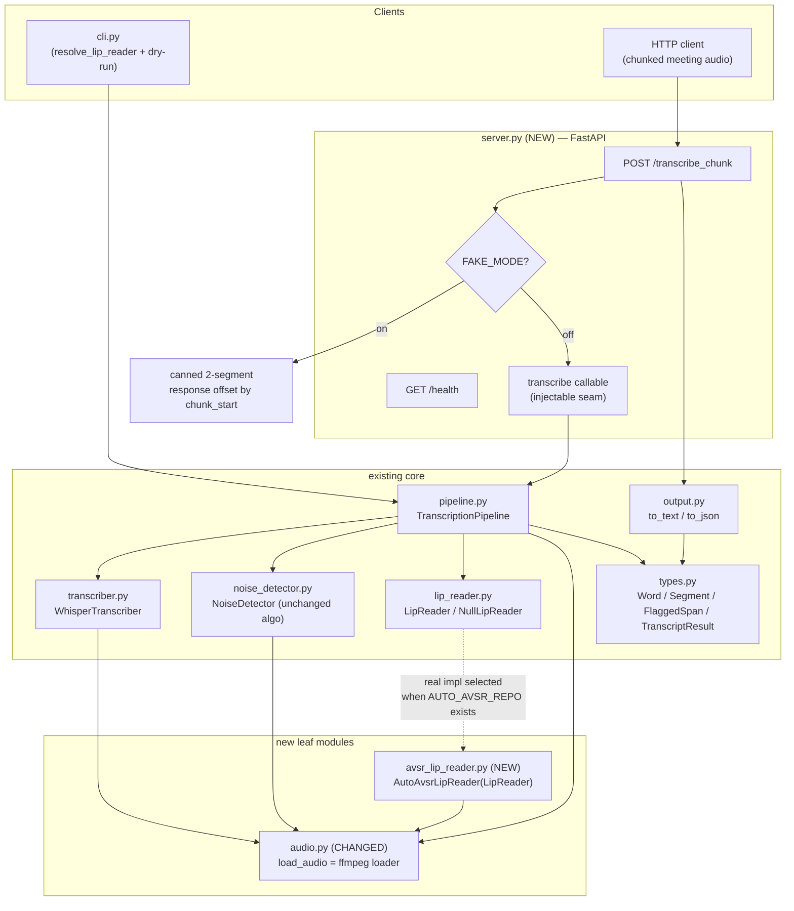
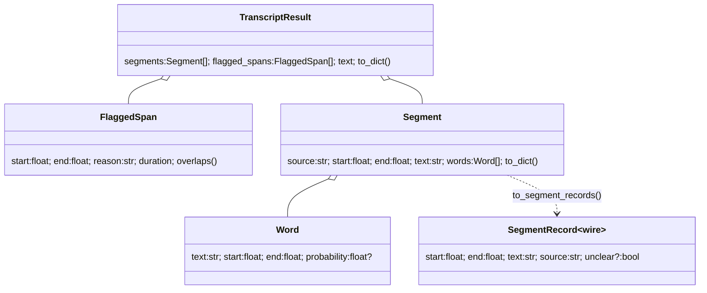

# Design Document

## Overview

This design ports the validated Colab prototype (`colab_reference/backend.py`, `colab_reference/server.py`) into the existing `zoom_lip_read` package without disturbing its structure, public types, configuration system, or tests. The integration adds three capabilities the package lacks today:

1. A real visual-speech-recognition (VSR) lip reader (`AutoAvsrLipReader`) that drops into the pipeline through the existing `LipReader.read_segment(video_path, start, end)` contract.
2. An ffmpeg-based audio loader that becomes the single audio source for both Whisper and the noise detector, avoiding newer-PyAV breakage in library file loaders.
3. A FastAPI HTTP server (`Transcription_Server`) that transcribes media chunks and returns timed segments, mirroring the reference server contract exactly (including FAKE_MODE).

The hard constraint shaping every decision: the package, including the two new modules, must import and the test suite must pass on a plain Windows machine with only `numpy` (and, for server tests, FastAPI's `TestClient`) installed — no `torch`, `cv2`, `mediapipe`, `faster_whisper`, the real model, a GPU, or the `ffmpeg` binary. We achieve this with **lazy imports** (heavy libraries imported only inside methods that need them) and **dependency-injection seams** (the server accepts an injectable transcription callable; the pipeline accepts an injected `LipReader`).

A second decision recorded in Requirement 4 drives the audio path: the existing `NoiseDetector` (RMS + spectral flatness over fixed windows) is **kept as-is**; only its audio *source* changes to the ffmpeg loader. The reference backend's dB-based `detect_noisy_spans` is intentionally **not** adopted. "Match the backend exactly" therefore applies to the lip reader and the server/response contract, not to the detector.

### Research notes informing the design

- **PyAV / faster-whisper breakage.** The reference backend documents (in `AudioASR.words`) that it passes a numpy waveform to `faster_whisper` rather than a file path, because newer PyAV raises `unexpected keyword argument 'metadata_errors'` inside faster-whisper's own loader. The same class of breakage affects `librosa.load` on some stacks. This is the direct motivation for Requirement 3 (route all decoding through one ffmpeg helper). Reference: faster-whisper's `WhisperModel.transcribe` accepts either a path or a numpy array of 16 kHz mono float32 samples — see the [faster-whisper README](https://github.com/SYSTRAN/faster-whisper). Content was rephrased for compliance with licensing restrictions.
- **auto_avsr import surface.** The reference `LipReader` imports `lightning` (the repo's own `ModelModule`), `datamodule.transforms.VideoTransform`, and `preparation.detectors.mediapipe.*` from the cloned `auto_avsr` repo added to `sys.path`. These only resolve on a host where the repo exists, so they must be deferred. The repo chooses between the mediapipe *solutions* API and the newer *tasks* API via `hasattr(mp, "solutions")`. Requirement 9.2 notes the pip package `lightning` clashes with `auto_avsr`'s own `lightning.py`; `pytorch-lightning` is used instead.
- **mediapipe tasks face detector.** `TasksLandmarksDetector` uses `vision.FaceDetector` with the BlazeFace short-range TFLite model, picks the largest-area detection per frame, and takes the first 4 keypoints scaled to pixel coordinates — ported unchanged.

---

## Architecture

The package keeps its layered shape. New modules are additive; changed modules keep their public API.



Key flows:

- **CLI path (existing behavior preserved):** `cli.resolve_lip_reader` now returns `AutoAvsrLipReader` when `AUTO_AVSR_REPO` exists, `NullLipReader` for `--dry-run` or when the repo is absent. Whisper size stays `base`.
- **Server path (new):** `POST /transcribe_chunk` → FAKE_MODE short-circuit *or* injected `transcribe` callable → segments → `{chunk_index, segments}`. Whisper size `small.en` for this path.
- **Audio source unification:** `audio.load_audio` becomes the ffmpeg decoder. `WhisperTranscriber`, `NoiseDetector` (via the pipeline), and `AutoAvsrLipReader` all read through it.

### Dependency-injection seams (import safety)

| Seam | Where | Purpose |
|------|-------|---------|
| `LipReader` instance | `TranscriptionPipeline(lip_reader=...)` (existing) | Tests inject `NullLipReader`; CLI injects `AutoAvsrLipReader`. |
| `transcribe` callable | `server.create_app(transcribe=...)` app factory | Tests inject a fake/NullLipReader-backed transcribe so the non-fake path runs with no heavy deps. |
| Lazy imports | inside `AutoAvsrLipReader` methods and `audio.load_audio` | `import torch/cv2/mediapipe/auto_avsr/subprocess` happen at call time, not import time. |

---

## Components and Interfaces

### 1. `zoom_lip_read/avsr_lip_reader.py` (NEW) — `AutoAvsrLipReader`

Ports the reference `LipReader`, `TasksLandmarksDetector`, and `read_frames` behavior unchanged, but adapts the public method to the base-class 3-argument contract and makes all heavy imports lazy. (Requirement 1.)

```python
# module-level: ONLY stdlib + typing at import time. NO torch/cv2/mediapipe/auto_avsr.
from __future__ import annotations
import os, sys
from pathlib import Path
from .lip_reader import LipReader

TARGET_FPS = 25
MAX_SIDE = 960
PAD_TO_SEC = 2.0

def _env_path(name: str, default: str) -> str:
    """Return os.environ[name] if set and non-empty, else default."""   # R1.13-15

class AutoAvsrLipReader(LipReader):
    def __init__(self,
                 repo: str | None = None,
                 ckpt: str | None = None,
                 face_tflite: str | None = None) -> None:
        self.repo = _env_path("AUTO_AVSR_REPO", "/content/auto_avsr") if repo is None else repo
        self.ckpt = _env_path("AVSR_CKPT",
                              "/content/auto_avsr/tutorials/vsr_trlrs2lrs3vox2avsp_base.pth") if ckpt is None else ckpt
        self.face_tflite = _env_path("FACE_TFLITE",
                              "/content/auto_avsr/tutorials/blaze_face_short_range.tflite") if face_tflite is None else face_tflite
        # Heavy construction deferred to _ensure_model(): torch, lightning, auto_avsr.
        self._model = None
        self._video_process = None
        self._video_transform = None
        self._landmarks_detector = None
        self._device = None

    # ---- lazy, heavy construction (R1.6, R1.16) ----
    def _ensure_model(self) -> None:
        if self._model is not None:
            return
        if self.repo and self.repo not in sys.path:
            sys.path.insert(0, self.repo)                      # R1.13 sys.path insertion
        import torch                                           # lazy
        from lightning import ModelModule                     # auto_avsr's lightning.py
        from datamodule.transforms import VideoTransform
        from preparation.detectors.mediapipe.video_process import VideoProcess
        import mediapipe as mp
        if hasattr(mp, "solutions"):                           # R1.5 detector selection
            from preparation.detectors.mediapipe.detector import LandmarksDetector
            self._landmarks_detector = LandmarksDetector()
        else:
            self._landmarks_detector = _TasksLandmarksDetector(self.face_tflite)
        self._video_process = VideoProcess(convert_gray=False)
        self._video_transform = VideoTransform(subset="test")
        import argparse
        ckpt = torch.load(self.ckpt, map_location=lambda s, l: s)
        mm = ModelModule(argparse.Namespace(modality="video"))
        mm.model.load_state_dict(ckpt); mm.eval()
        self._device = torch.device("cpu")
        if torch.cuda.is_available():                          # R1.7 GPU attempt
            try:
                mm.to(torch.device("cuda")); self._device = torch.device("cuda")
            except Exception:                                  # R1.8 CPU fallback, no raise
                pass
        self._model = mm

    # ---- public contract: 3 args (R1.2) ----
    def read_segment(self, video_path: str | Path, start: float, end: float) -> str:
        try:
            self._ensure_model()
            s, e = self._pad(float(start), float(end), video_path)   # R1.10 padding
            seg_mp4 = self._extract_segment(str(video_path), s, e)   # ffmpeg -ss/-to -r25 -an
            crops = self._crops(seg_mp4)                             # read_frames + landmarks + process
            return self._decode(crops)                              # R1.6 strip().lower()
        except Exception:
            return ""                                               # R1.11, R1.12 never raise
```

Behavioral details ported unchanged:

- **`read_frames` (R1.3, R1.4):** `_read_frames(path)` opens the clip with `cv2.VideoCapture`, reads `src_fps`, and resamples to `TARGET_FPS=25` using the same next-timestamp accumulator (`next_t += 1/25`, skip frames whose `t < next_t`). For each kept frame, if `max(h, w) > MAX_SIDE` it computes `scale = MAX_SIDE / max(h, w)` and resizes with `INTER_AREA`; frames at or under 960 are left unscaled. Converts BGR→RGB, stacks to a numpy array, returns `(frames, src_fps)`. Raises if zero frames (caught by `read_segment`).
- **Landmark detection (R1.5):** `_TasksLandmarksDetector` wraps mediapipe `vision.FaceDetector` with `min_detection_confidence=0.5`, per frame selects the detection with the largest `bounding_box.width * bounding_box.height`, takes the first 4 keypoints scaled to pixels, appends `None` when no face. Asserts at least one frame had a face.
- **Decode (R1.6, R1.8):** `_decode(crops)` builds `torch.tensor(crops).permute(0,3,1,2)`, applies `VideoTransform`, runs `with torch.no_grad()` on `self._device`; on a CUDA `RuntimeError` it moves the model to CPU and retries, matching the reference GPU→CPU decode fallback. Returns `(text or "").strip().lower()`.
- **Padding (R1.10):** `_pad(start, end, video_path)` — when `end - start < PAD_TO_SEC`, `mid = (start+end)/2`, returns `(max(0.0, mid - 1.0), min(clip_duration, mid + 1.0))`. `clip_duration` is derived internally (see below). This matches the reference `pad_to_sec = 2.0` with half-pad on each side.
- **Segment extraction:** `_extract_segment` writes to a temp file inside a per-call `tempfile.TemporaryDirectory()` and invokes `ffmpeg -y -ss {s} -to {e} -i {video} -r 25 -an -c:v libx264 -preset veryfast {seg}` via `subprocess.run` (lazy `import subprocess`).

**Deriving `total`/`workdir` for the 3-arg signature.** The reference `read_segment(video_path, start, end, total, workdir)` receives the clip duration and a shared temp dir from its caller. The base-class contract the pipeline calls is 3-arg. The design resolves this internally:

- **`total` (clip duration):** obtained via a lazy `_clip_duration(video_path)` helper that calls `ffprobe -v error -show_entries format=duration -of csv=p=0 {path}` (ported from the reference `duration()`), returning `0.0` on failure. Used only to clamp the padded `end`. If `ffprobe` is unavailable the exception is caught and `read_segment` returns `""` (never raises).
- **`workdir`:** each `read_segment` call creates and tears down its own `tempfile.TemporaryDirectory()` (context-managed), so no shared workdir parameter is needed. Temp segment files are removed when the call returns.

This keeps `AutoAvsrLipReader` a drop-in for `TranscriptionPipeline`, which only ever calls `self.lip_reader.read_segment(video_path, span.start, span.end)`.

### 2. `zoom_lip_read/audio.py` (CHANGED) — ffmpeg loader

Replace the librosa body of `load_audio` with the ported ffmpeg decoder (Requirement 3). Keep the same function name and signature so existing callers are unaffected.

```python
def load_audio(path: str | Path, sample_rate: int = 16000) -> np.ndarray:
    """Decode any media file to mono float32 at `sample_rate` via the ffmpeg binary.

    Returns a 1-D float32 array normalized to [-1.0, 1.0). Empty array when the
    input yields no audio bytes. (R3.1, R3.4, R3.5)
    """
    import subprocess          # lazy (R3.5): importing the package needs no ffmpeg binary
    cmd = ["ffmpeg", "-i", str(path), "-f", "s16le", "-ac", "1", "-ar", str(sample_rate), "-"]
    raw = subprocess.run(cmd, capture_output=True).stdout
    if not raw:
        return np.zeros(0, dtype=np.float32)        # R3.4 empty on no audio
    return np.frombuffer(raw, np.int16).astype(np.float32) / 32768.0   # R3.1 normalize
```

Notes:
- `sample_rate` defaults to 16000 to match the reference and the pipeline's `PipelineConfig.sample_rate`.
- A `has_audio(path, sample_rate=16000)` helper is added for the server/backend path (Requirement 7.5): `return len(load_audio(path, sample_rate)) > sample_rate * 0.2`.
- `np` is imported at module top (numpy is always available); only `subprocess` is lazy.

**Wiring (Requirement 3.2, 3.3):**

- `WhisperTranscriber.transcribe` changes one line: instead of `model.transcribe(str(audio_path), ...)` it does
  ```python
  from .audio import load_audio
  waveform = load_audio(audio_path, 16000)       # R3.2 pass numpy, not a path
  segments, info = model.transcribe(waveform, word_timestamps=True,
                                    language=self.config.language,
                                    beam_size=self.config.beam_size,
                                    vad_filter=self.config.vad_filter)
  ```
  Because faster-whisper no longer sees a file it cannot report container `duration`; the pipeline already takes `max(clip_duration, whisper_duration)` where `clip_duration = len(waveform)/sample_rate`, so duration remains correct.
- `TranscriptionPipeline.run` already calls `load_audio(video_path, self.config.sample_rate)` and passes the waveform to `self.detector.detect(waveform)`. With `audio.load_audio` now ffmpeg-based, the `NoiseDetector` waveform source is the ffmpeg loader with **no change to `NoiseDetector` or `NoiseDetectorConfig`** (Requirement 4.1–4.3). The detector still receives a plain numpy array and its windowing/merging logic is untouched, so `tests/test_logic.py` (which builds waveforms directly and stubs `librosa.feature.spectral_flatness`) keeps passing unchanged.

### 3. `zoom_lip_read/server.py` (NEW) — `Transcription_Server`

FastAPI app mirroring `colab_reference/server.py` exactly, plus an app factory that exposes the transcription seam for tests. (Requirements 5, 6, 7, 8, 10.)

```python
from __future__ import annotations
import os, tempfile, threading
from typing import Callable

def fake_mode_enabled() -> bool:
    """FAKE_MODE on when env unset or '1'; off for any other value. (R5.3)"""
    return os.environ.get("FAKE_MODE", "1") == "1"

def _canned_segments(chunk_start: float) -> list[dict]:
    t = chunk_start
    return [
        {"start": t,       "end": t + 2.6, "text": "let's meet friday", "source": "audio"},
        {"start": t + 2.6, "end": t + 4.7, "text": "see you then", "source": "lip", "unclear": False},
    ]   # R5.5 exactly two segments, offset by chunk_start

def create_app(transcribe: Callable[..., list[dict]] | None = None) -> "FastAPI":
    from fastapi import FastAPI, UploadFile, File, Form
    from fastapi.middleware.cors import CORSMiddleware
    app = FastAPI()
    app.add_middleware(CORSMiddleware, allow_origins=["*"],
                       allow_methods=["*"], allow_headers=["*"])
    lock = threading.Lock()                                  # R5.8 one-at-a-time
    _transcribe = transcribe or _default_transcribe          # injectable seam (R10.4)

    @app.get("/health")
    def health():
        return {"status": "ok", "fake_mode": fake_mode_enabled()}     # R5.2

    @app.post("/transcribe_chunk")
    def transcribe_chunk(file: UploadFile = File(...),
                         session_id: str = Form(...),
                         chunk_index: int = Form(...),
                         chunk_start: float = Form(0.0),
                         mode: str = Form("auto")):           # R5.4 form fields + defaults
        if fake_mode_enabled():
            return {"chunk_index": chunk_index,
                    "segments": _canned_segments(chunk_start)}        # R5.5
        suffix = os.path.splitext(file.filename or "")[1] or ".webm"  # R5.6 preserve ext
        with lock:                                           # R5.8
            with tempfile.TemporaryDirectory() as tmp:       # R5.7 deleted on return
                path = os.path.join(tmp, "upload" + suffix)
                with open(path, "wb") as f:
                    f.write(file.file.read())
                segments = _transcribe(path, chunk_start=chunk_start, mode=mode)
        return {"chunk_index": chunk_index, "segments": segments}     # R5.10

app = create_app()        # module-level default app (R5.1); uses the real transcribe path
```

- **`_default_transcribe`** is the backend-style entry (see below). It is only *called* in non-fake mode, so merely importing `server` never triggers heavy imports (Requirement 10.1). The `create_app(transcribe=...)` factory lets tests inject a light transcribe.
- `GET /health` returns `{"status": "ok", "fake_mode": <bool>}` (R5.2). `fake_mode` reflects the *current* env read, matching the reference reading at request time via `fake_mode_enabled()`.
- **CORS** open to all origins/methods/headers (matches reference).
- **Temp dir lifecycle (R5.7):** `TemporaryDirectory()` context manager deletes the dir and upload whether transcription succeeds or raises.
- **Lock (R5.8):** a single `threading.Lock` guards the non-fake path for one-at-a-time GPU use.

#### Backend-style transcribe entry (`_default_transcribe`)

This is the server's internal transcription path (Requirement 5.6, 5.11, 7, 8). It mirrors `backend.transcribe` while producing `Segment_Record`s, and it is written to be overridable (the injected callable in tests). Two valid implementations satisfy Requirement 5.11 ("same response contract regardless of whether the path uses TranscriptionPipeline or a backend-style function"); we choose the **backend-style function** to match the validated prototype's grouping/offset behavior exactly, and reuse existing package pieces where they are behavior-identical:

```python
def _default_transcribe(path: str, chunk_start: float = 0.0, mode: str = "auto") -> list[dict]:
    """Mirror backend.transcribe: whisper words -> grouped audio segments +
    per-span lip segments, offset by chunk_start. Whisper size small.en (R8.2)."""
    from .audio import load_audio, has_audio
    from .config import PipelineConfig, WhisperConfig
    from .transcriber import WhisperTranscriber
    from .noise_detector import NoiseDetector
    from .avsr_lip_reader import AutoAvsrLipReader

    import tempfile, os
    cfg = PipelineConfig(whisper=WhisperConfig(model_size="small.en"))   # R8.2

    # Normalize the upload to a single 25 fps mp4 up front so the audio and lip
    # paths share one consistent timeline (R5.12, R5.13). A normalization
    # failure must not raise out of the request (R5.14): fall back to the raw
    # upload so downstream best-effort paths still run.
    with tempfile.TemporaryDirectory() as tmp:
        mp4 = os.path.join(tmp, "chunk.mp4")
        try:
            _to_mp4_25fps(path, mp4)                         # R5.12 ffmpeg 25fps + 16k mono aac
            media = mp4
        except Exception:
            media = path                                     # R5.14 degrade, do not raise

        total = _clip_duration(media)                        # ffprobe on the normalized mp4
        waveform = load_audio(media, 16000)

        if mode == "lip_only" or not has_audio(media):       # R7.2, R7.4, R7.5
            spans, words = [(0.0, total)], []
        else:
            words = WhisperTranscriber(cfg.whisper).transcribe(media)[0]
            if mode == "audio_only":                         # R7.1
                spans = []
            else:                                            # auto (R7.3, R7.6)
                flagged = NoiseDetector(cfg.noise, cfg.sample_rate).detect(waveform)
                spans = [(s.start, s.end) for s in flagged] or ([] if waveform.size else [(0.0, total)])

        reader = AutoAvsrLipReader()
        records = _group_words([w for w in words if not _in_span(w, spans)], chunk_start)
        for a, b in spans:                                   # R7.3 one lip seg per span
            text = reader.read_segment(media, a, b)          # same normalized timeline (R5.13)
            records.append({"start": round(a + chunk_start, 2), "end": round(b + chunk_start, 2),
                            "text": text, "source": "lip", "unclear": text == ""})   # R6.2-6.4
        records.sort(key=lambda r: r["start"])               # R5.9 offset already applied
        return records
```

- **`_group_words(words, offset)`** ports the reference `group_words`: starts a new audio segment when the gap to the previous word exceeds `1.0s`, otherwise extends it; then rounds `start`/`end` to 2 decimals after adding `offset` (R5.9, R6.1).
- **`_in_span(word, spans)`** ports the reference `in_span`: a word belongs to a span when its time midpoint `(start+end)/2` falls inside any `[a, b]` (R7.3).
- **`_to_mp4_25fps(src, dst)`** ports the reference `to_mp4_25fps` (lazy `import subprocess`): runs `ffmpeg -y -i {src} -map 0:v:0 -map 0:a:0? -r 25 -c:v libx264 -preset veryfast -c:a aac -ar 16000 -ac 1 {dst}`, producing a 25 fps mp4 with 16 kHz mono audio. `_default_transcribe` calls it once per request inside its own `tempfile.TemporaryDirectory()` and runs `_clip_duration`, `load_audio`, `has_audio`, and `read_segment` against the normalized mp4, so audio words and lip spans sit on one timeline (R5.12, R5.13). If normalization fails the request degrades to the raw upload rather than raising (R5.14).
- **Relationship to `backend.transcribe`:** same control flow (mode branch → words → group → per-span lip read → sort) and the same 1.0s grouping and midpoint-in-span tests. Differences: it uses the package's `AutoAvsrLipReader` (3-arg `read_segment`, which internally handles padding and ffmpeg extraction) instead of the reference reader's 5-arg method, and it uses the package `NoiseDetector` rather than `detect_noisy_spans`. The output `Segment_Record` shape is identical.
- **Whisper size (R8):** this integrated path uses `small.en`; the CLI/pipeline path keeps `WhisperConfig.model_size = "base"` (unchanged default).

### 4. `zoom_lip_read/cli.py` (CHANGED) — lip reader selection

```python
def resolve_lip_reader(dry_run: bool) -> LipReader:
    if dry_run:
        return NullLipReader()                               # R2.3
    import os
    repo = os.environ.get("AUTO_AVSR_REPO") or "/content/auto_avsr"
    if os.path.isdir(repo):                                  # R2.1
        from .avsr_lip_reader import AutoAvsrLipReader
        return AutoAvsrLipReader()
    return NullLipReader()                                   # R2.2 graceful fallback
```

The previous `raise SystemExit(...)` is removed; absence of the repo now falls back to `NullLipReader` so dry runs work anywhere. `AutoAvsrLipReader` is imported lazily inside the function so the CLI module import stays light.

### 5. `zoom_lip_read/output.py` + `types.py` — Segment_Record serialization

`output.to_text` / `to_json` and the `[lip-read: ...]` wrapping are retained unchanged (Requirement 6.5). For the server response contract we add an exact-keys serializer so the server never leaks the `words` list that `Segment.to_dict` includes:

```python
# output.py
def to_segment_records(result: TranscriptResult) -> list[dict]:
    """Server-shaped records: exactly {start,end,text,source}(+unclear for lip). (R6.1-6.4)"""
    out = []
    for seg in result.segments:
        rec = {"start": seg.start, "end": seg.end, "text": seg.text, "source": seg.source}
        if seg.source == "lip":
            rec["unclear"] = (seg.text.strip() == "")
        out.append(rec)
    return out
```

The server's `_default_transcribe` builds records directly (shown above), so `to_segment_records` is the bridge for the *pipeline-backed* alternative allowed by Requirement 5.11 and for tests that want to convert a `TranscriptResult` to the wire shape. We deliberately do **not** change `Segment.to_dict` (it keeps `words` for the rich JSON export used by the CLI); the exact-key shape lives in the dedicated serializer.

### 6. `requirements.txt` (CHANGED)

Resulting intent (Requirement 9):

```
faster-whisper>=1.0.0
librosa>=0.10.0
soundfile>=0.12.1
numpy>=1.24.0
fastapi
uvicorn[standard]
python-multipart
pytorch-lightning
av
mediapipe
```

- Add `fastapi`, `uvicorn[standard]`, `python-multipart` for the server (R9.1).
- Add `pytorch-lightning`, **not** `lightning`, because the `lightning` package shadows `auto_avsr`'s own `lightning.py` module (R9.2).
- Add `av` and `mediapipe` **unpinned** (R9.3).
- `torch`, `cv2`/`opencv`, and `auto_avsr` are intentionally not added to `requirements.txt`: they come from the GPU host's environment (auto_avsr clone + its own install), and keeping them out preserves Windows importability of the package.

---

## Data Models

### Segment_Record (wire format)

The server/backend response segment. Exact key sets (Requirement 6):

| Field | Type | Audio seg | Lip seg | Notes |
|-------|------|-----------|---------|-------|
| `start` | float | ✓ | ✓ | seconds, already offset by `chunk_start`, rounded to 2 dp |
| `end` | float | ✓ | ✓ | seconds, offset + rounded |
| `text` | str | ✓ | ✓ | transcript text |
| `source` | str | `"audio"` | `"lip"` | discriminator |
| `unclear` | bool | — (absent) | ✓ | `true` iff `text == ""` (R6.3/6.4) |

Audio records have **exactly** `{start, end, text, source}`; lip records have **exactly** `{start, end, text, source, unclear}`. No `words`, `probability`, or `reason` keys appear on the wire.

### Relationship to existing types

- **`Word`** (`types.py`) — unchanged. `WhisperTranscriber` keeps returning `List[Word]`.
- **`FlaggedSpan`** — unchanged; produced by `NoiseDetector`. Server path reads `(span.start, span.end)` tuples from it.
- **`Segment`** — unchanged; `source` ∈ {`"audio"`, `"lip"`}, carries `words` and `to_dict()` (with `words`) for the CLI's rich JSON. A `Segment` maps to a `Segment_Record` by dropping `words` and, for lip segments, adding `unclear = (text == "")` via `output.to_segment_records`.
- **`TranscriptResult`** — unchanged; `.text` still wraps lip spans as `[lip-read: ...]` (R6.5). The CLI continues to use `TranscriptResult.to_dict()`; only the server uses the exact-keys serializer.



---

## Correctness Properties

*A property is a characteristic or behavior that should hold true across all valid executions of a system — essentially, a formal statement about what the system should do. Properties serve as the bridge between human-readable specifications and machine-verifiable correctness guarantees.*

These properties cover the parts of the feature that are pure, input-varying logic. Heavy-I/O and environment-dependent criteria (real model inference, GPU selection, mediapipe detection, ffmpeg decode of real media, dependency-manifest contents, and import-safety facts) are not expressed as properties; they are covered by examples, edge cases, integration tests, or smoke checks in the Testing Strategy. To keep every property runnable on Windows with only numpy, the properties target extracted pure helpers (`_scaled_size`, `_pad`, `_env_path`, `fake_mode_enabled`, `has_audio`, the int16→float step, the word/span partition, the offset step, and the `Segment_Record` serializer) and the injectable server/CLI seams.

### Property 1: Frame downscaling caps the larger side at 960 and preserves aspect ratio

*For all* integer frame dimensions `(h, w)` with `1 <= h, w <= 4000`: if `max(h, w) <= 960` then `_scaled_size(h, w) == (h, w)` (unchanged); otherwise `max(_scaled_size(h, w)) == 960` and the aspect ratio is preserved within one pixel of rounding.

**Validates: Requirements 1.4**

### Property 2: `read_segment` never raises and returns "" on any internal failure

*For all* injected failures at any internal stage of `AutoAvsrLipReader.read_segment` (model load, frame read, landmark detection, or decode), the call returns the empty string and propagates no exception.

**Validates: Requirements 1.8, 1.11, 1.12**

### Property 3: Environment path resolution falls back to the default

*For all* environment-variable states `v` (unset, empty, or any non-empty string) and for each of `AUTO_AVSR_REPO`, `AVSR_CKPT`, `FACE_TFLITE`: `_env_path(name, default)` returns `default` when `v` is unset or empty, and returns `v` otherwise.

**Validates: Requirements 1.13, 1.14, 1.15**

### Property 4: CLI lip-reader selection follows the dry-run/repo truth table

*For all* combinations of `dry_run ∈ {True, False}` and `repo_exists ∈ {True, False}`: `resolve_lip_reader` returns a `NullLipReader` when `dry_run` is True; otherwise it returns an `AutoAvsrLipReader` when the `AUTO_AVSR_REPO` directory exists and a `NullLipReader` when it does not.

**Validates: Requirements 2.1, 2.2, 2.3**

### Property 5: Segment_Record key sets are exact and `unclear` is the empty-text biconditional

*For all* segments produced by either transcription path: an audio record's key set is exactly `{start, end, text, source}` with `source == "audio"`; a lip record's key set is exactly `{start, end, text, source, unclear}` with `source == "lip"` and `unclear == (text == "")`.

**Validates: Requirements 6.1, 6.2, 6.3, 6.4, 5.11**

### Property 6: Chunk-start offset is additive across every returned segment

*For all* chunk-start offsets `c >= 0` and for all base segment lists, every returned segment's `start` and `end` equals its base value plus `c` (within 2-decimal rounding), in both FAKE_MODE and the non-fake path.

**Validates: Requirements 5.5, 5.9**

### Property 7: `/health` reports status "ok" and FAKE_MODE mirrors the environment

*For all* values of the `FAKE_MODE` environment variable, `GET /health` returns `status == "ok"` and `fake_mode == true` exactly when the variable is unset or equals `"1"`, and `false` for any other value.

**Validates: Requirements 5.2, 5.3**

### Property 8: Transcription modes are mutually exclusive in which stage they run

*For all* inputs: in `audio_only` mode no produced segment has `source == "lip"` and the lip reader is never invoked; in `lip_only` mode the audio transcriber is never invoked and the output is exactly one lip record spanning `[chunk_start, round(duration + chunk_start, 2)]`.

**Validates: Requirements 7.1, 7.2**

### Property 9: `auto` mode partitions words by span midpoint and emits one lip segment per span

*For all* word lists and flagged-span lists in `auto` mode: a word is kept as audio content exactly when its time midpoint `(start + end) / 2` lies outside every span, and the number of lip segments in the output equals the number of spans.

**Validates: Requirements 7.3**

### Property 10: Absent or unreadable audio collapses the chunk to a single full-length lip span

*For all* clip durations `d`, when audio is not usable (or is unreadable by the detector) in `auto` or `audio_only` mode, the output is exactly one lip record spanning `[chunk_start, round(d + chunk_start, 2)]`.

**Validates: Requirements 7.4, 7.6**

### Property 11: Audio is usable iff the decoded waveform exceeds 0.2 seconds

*For all* non-negative sample counts `n`, `has_audio` applied to a 16 kHz waveform of length `n` returns `True` exactly when `n > 16000 * 0.2`.

**Validates: Requirements 7.5**

### Property 12: Short-segment padding is centered on the midpoint and clamped to the clip

*For all* `(start, end, total)` with `0 <= start <= end <= total`: `_pad(start, end, total)` returns a span within `[0, total]`; when `end - start < 2.0` the result is `(max(0.0, mid - 1.0), min(total, mid + 1.0))` where `mid = (start + end) / 2`; otherwise it returns `(start, end)` unchanged.

**Validates: Requirements 1.10**

### Property 13: int16→float32 decoding normalizes samples into [-1.0, 1.0)

*For all* int16 sample arrays, decoding their little-endian bytes yields a float32 array equal elementwise to `samples / 32768.0`, with every value in the range `[-1.0, 1.0)`.

**Validates: Requirements 3.1**

### Property 14: Normalization precedes transcription on a single timeline

*For all* non-fake requests, `_default_transcribe` invokes the 25 fps normalizer exactly once, and every downstream stage (`_clip_duration`, `load_audio`, `has_audio`, and each `read_segment` call) receives the normalized mp4 path rather than the raw upload. When the normalizer raises, every downstream stage receives the raw upload path instead and the call still returns without raising.

**Validates: Requirements 5.12, 5.13, 5.14**

---

## Error Handling

| Condition | Component | Behavior | Requirement |
|-----------|-----------|----------|-------------|
| No face in any frame, unreadable segment frames, decode failure | `AutoAvsrLipReader.read_segment` | Catch all exceptions, return `""`; lip record then carries `unclear = true` | 1.11, 1.12, 6.3 |
| GPU move fails (`.to(cuda)` raises) | `AutoAvsrLipReader._ensure_model` | Catch, stay on CPU, continue | 1.8 |
| GPU decode raises `RuntimeError` | `AutoAvsrLipReader._decode` | Move model to CPU, retry once on CPU | 1.8 |
| `ffprobe`/`ffmpeg` missing or errors during a segment read | `AutoAvsrLipReader` helpers | Exception caught by `read_segment` → `""` | 1.11, 1.12 |
| ffmpeg yields no audio bytes | `audio.load_audio` | Return empty float32 array (no raise) | 3.4 |
| No usable audio for the chunk | server `_default_transcribe` | Treat whole chunk as one lip span `[0, total]` | 7.4, 7.5 |
| 25 fps normalization (`_to_mp4_25fps`) fails | server `_default_transcribe` | Catch, fall back to the raw upload path, continue without raising | 5.14 |
| Detector cannot read audio in `auto` | server `_default_transcribe` | Treat whole chunk as one lip span `[0, total]` | 7.6 |
| Transcription raises mid-request | `POST /transcribe_chunk` | `TemporaryDirectory` context deletes temp files; exception surfaces as FastAPI 500 after cleanup | 5.7 |
| Concurrent non-fake requests | `POST /transcribe_chunk` | `threading.Lock` serializes; second request waits | 5.8 |
| Missing/absent heavy libs at import | all new modules | Lazy imports: module import never touches torch/cv2/mediapipe/auto_avsr/faster_whisper/ffmpeg | 1.16, 3.5, 10.1 |

Design stance: the lip-reading path is *best-effort* — any failure degrades to an empty lip segment (flagged `unclear`) rather than failing the whole transcription. Audio decoding failures degrade to empty waveforms, which the mode logic then treats as "no usable audio."

## Testing Strategy

The suite must run on Windows with only `numpy` plus FastAPI's `TestClient`, never touching the real model, GPU, ffmpeg media, mediapipe, torch, or faster-whisper (Requirement 10.5). Two mechanisms make that possible: **lazy imports** (heavy deps imported only inside methods actually exercised on the GPU host) and **injection seams** (`TranscriptionPipeline(lip_reader=...)`, `server.create_app(transcribe=...)`, and fakeable `audio.load_audio` / `WhisperTranscriber`).

### Property-based tests

- **Library:** `hypothesis` (the standard Python PBT library). Do not hand-roll generators/shrinking.
- **Iterations:** each property test runs a minimum of 100 examples (`@settings(max_examples=100)` or higher).
- **Coverage:** one property-based test per property P1–P13 above, targeting the extracted pure helpers and the injectable seams so no heavy dependency is required.
- **Tagging:** each property test carries a comment in the form
  `# Feature: colab-integration, Property {n}: {property_text}`
  referencing the design property it implements.
- **Notes on specific properties:**
  - P2 (never-raise) uses an `AutoAvsrLipReader` subclass/monkeypatch whose internal stages raise injected exceptions; no torch needed.
  - P5/P6/P8/P9/P10 drive the server's `_default_transcribe` with a fake whisper (returns generated `Word`s), a `NullLipReader`-style lip reader, and a fake `load_audio`/`ffprobe`, so the full mode logic runs in-memory.
  - P7 flips the `FAKE_MODE` env and calls `/health` through `TestClient`.

### Example-based unit tests

- Module/structure facts: `issubclass(AutoAvsrLipReader, LipReader)`; `read_segment` signature arity; `server.app` is a FastAPI instance; `WhisperConfig().model_size == "base"` (R8.1); server path builds `WhisperConfig(model_size="small.en")` via a construction spy (R8.2).
- Wiring: `WhisperTranscriber.transcribe` passes an `np.ndarray` to the (faked) whisper model, not a path (R3.2); the pipeline feeds the detector the output of a spied `load_audio` (R3.3).
- Canned FAKE_MODE content: exact two-segment response text/shape (R5.5 content half).
- `/transcribe_chunk` envelope: echoes `chunk_index`, returns a `segments` list, applies form-field defaults (R5.4, R5.10).
- `[lip-read: ...]` export retained (R6.5).
- Requirements manifest: `requirements.txt` contains `fastapi`, `uvicorn[standard]`, `python-multipart`, `pytorch-lightning` (and not a bare `lightning` line), and unpinned `av`/`mediapipe` (R9.1–9.3).

### Edge-case tests

- `load_audio` returns a length-0 float32 array when faked `subprocess` stdout is empty (R3.4).
- Temp dir/upload removed after `/transcribe_chunk` both when the injected transcribe returns and when it raises (R5.7).

### Required server tests (Requirement 10.3, 10.4)

1. **FAKE_MODE test:** `TestClient` with FAKE_MODE on hits `GET /health` (asserts `status == "ok"`, `fake_mode == true`) and `POST /transcribe_chunk` (asserts the canned two-segment response, offset by `chunk_start`) — no model loaded.
2. **Non-fake injected test:** `create_app(transcribe=fake)` where `fake` is a `NullLipReader`-backed transcription (or a direct fake returning `Segment_Record`s) with `FAKE_MODE=0`; posts a small dummy file and asserts the returned segments, the preserved file extension, and that no heavy module was imported.

### Import-safety tests (Requirement 10.1)

A `sys.meta_path` blocker (raising `ImportError` for `torch`, `cv2`, `mediapipe`, `faster_whisper`) is installed, then `import zoom_lip_read`, `import zoom_lip_read.server`, and `import zoom_lip_read.avsr_lip_reader` must all succeed, and those heavy modules must be absent from `sys.modules` afterward.

### Non-regression (Requirement 10.2, 4.1–4.3)

`tests/test_logic.py` runs unchanged and must keep passing: `NoiseDetector`, `NoiseDetectorConfig`, span merging, pipeline assembly, and config round-trip are untouched by this change.

### Integration / host-only tests (not run in CI on Windows)

Documented but gated behind the presence of the `auto_avsr` repo + GPU: real `read_frames` frame-count check (R1.3), mediapipe largest-bbox selection (R1.5), real model decode to expected text (R1.6), GPU vs CPU selection (R1.7, R1.9), and a real ffmpeg decode of a known clip (R3.1 decode half). These exercise the paths the property/unit tests deliberately stub.
